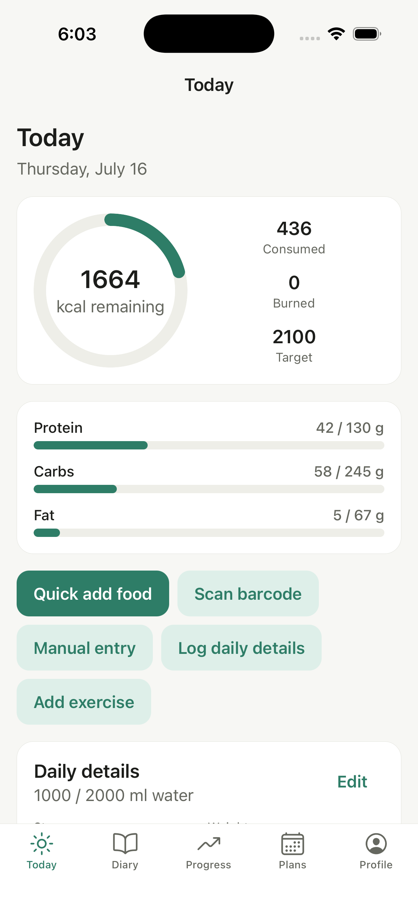
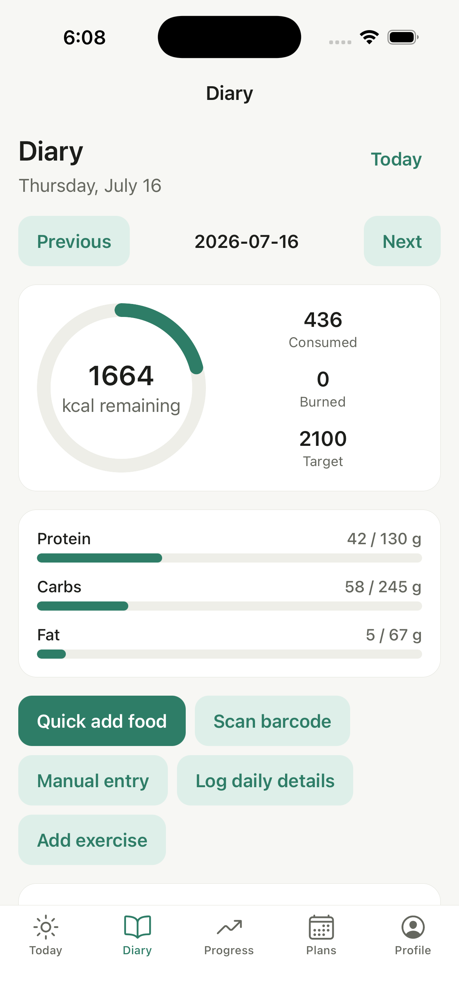
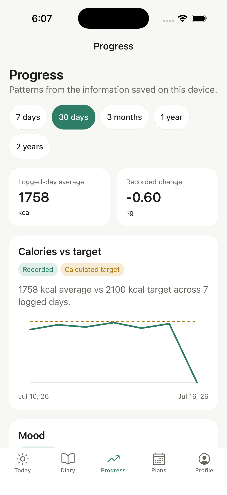
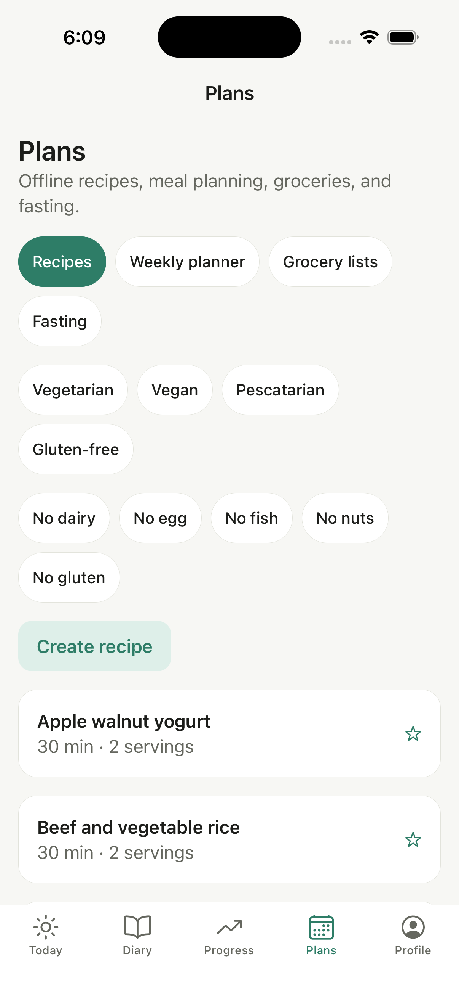

# CalorieTracker (working title)

Personal, **single-user, local-first** nutrition & lifestyle tracker for iOS/Android: food diary, calorie/macro goals, local Greek food database (+ optional Open Food Facts lookup), barcode scanning, recipes & meal planning, intermittent fasting, health-platform sync, and progress analytics. Greek + English, metric units, dark/light themes.

**No accounts, no backend, no cloud, no API keys, no ads, no telemetry.** All data lives in the on-device SQLite database, which is the primary and authoritative store. The app works fully offline except optional lookups (e.g. a previously unknown barcode).

**Start here:** [docs/PRODUCT_SPEC.md](docs/PRODUCT_SPEC.md) (product specification) → [docs/ROADMAP.md](docs/ROADMAP.md) (current milestone).

## Screenshots

<table>
  <tr>
    <td align="center"><strong>Today</strong></td>
    <td align="center"><strong>Diary</strong></td>
  </tr>
  <tr>
    <td></td>
    <td></td>
  </tr>
  <tr>
    <td align="center"><strong>Progress</strong></td>
    <td align="center"><strong>Plans</strong></td>
  </tr>
  <tr>
    <td></td>
    <td></td>
  </tr>
</table>

## Docs

| Doc                                                          | Contents                                             |
| ------------------------------------------------------------ | ---------------------------------------------------- |
| [docs/PRODUCT_SPEC.md](docs/PRODUCT_SPEC.md)                 | Feature specification                                |
| [docs/ARCHITECTURE.md](docs/ARCHITECTURE.md)                 | Local-first stack, layering, adapters, decisions log |
| [docs/DATA_MODEL.md](docs/DATA_MODEL.md)                     | SQLite schema, migrations, canonical nutrients       |
| [docs/SECURITY_AND_PRIVACY.md](docs/SECURITY_AND_PRIVACY.md) | Local threat model, data control                     |
| [docs/ROADMAP.md](docs/ROADMAP.md)                           | Milestones with scope/tests/acceptance               |
| [docs/TEST_STRATEGY.md](docs/TEST_STRATEGY.md)               | Test layers, E2E journeys, gates                     |
| [docs/API_AND_DATA_SOURCES.md](docs/API_AND_DATA_SOURCES.md) | Local Greek DB, Open Food Facts, optional providers  |

## Stack

Expo SDK 57 · React Native 0.86 · TypeScript (strict) · Expo Router · expo-sqlite (from M2) · Zod · i18next · Jest + React Native Testing Library.

## Getting started

```sh
cd ~/Desktop/CalorieTracker
npm install
npm start        # non-camera development
npx expo run:ios # native development build for barcode scanning
npx expo run:android
```

No configuration files, environment variables, accounts, or API keys are needed.

## Quality gates (all must pass before any commit)

```sh
npm run typecheck
npm run lint          # zero warnings policy
npm test
```

## Status

- ✅ M1 — Foundation & design system (tokens, themes, i18n en/el, UI kit, 5-tab shell)
- ✅ M2 — Local SQLite foundation (migrations, repositories, core tables, dev seeds)
- ✅ M3 — Personal profile and guarded calorie/macro targets
- ✅ M4 — Offline food diary (Today/Diary, manual logs, totals, undo, copy, custom meals)
- ✅ M5 — Local food catalog and search (150 bilingual foods, portions, favorites, templates)
- ✅ M6 — Barcode scanning (offline-first lookup, OFF cache, history, manual fallback)
- ✅ M7 — Progress and charts
- ✅ M8 — Recipes and grocery lists
- ✅ M9 — Weekly meal planning
- ✅ M10 — Intermittent fasting and mood trends
- ⏭️ M11 — Optional HealthKit and Health Connect integrations

## Disclaimer

All calorie and nutrient values are informational estimates, not medical advice.
